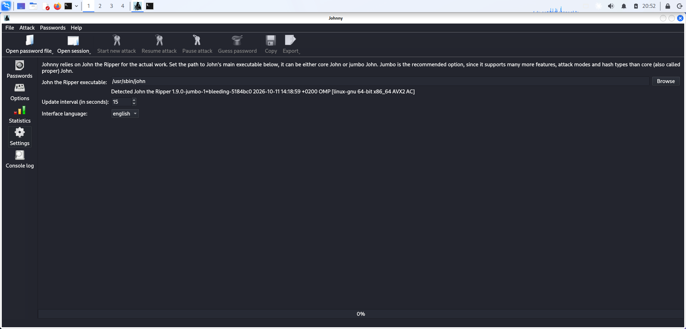
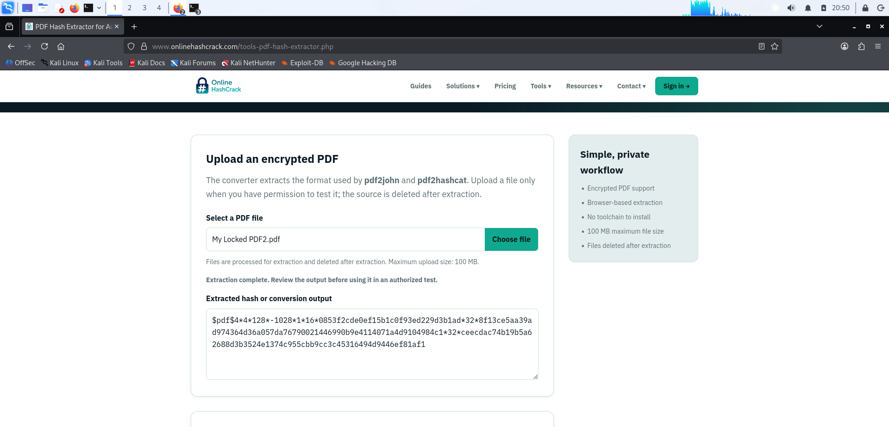
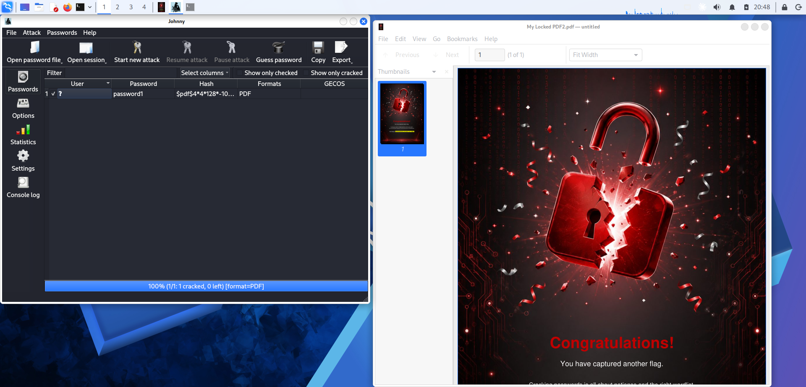

# Week 03 – Cybersecurity Internship | NetworkWalks

**Domain:** Cybersecurity  
**Week:** 03  
**Organization:** NetworkWalks

## Overview

This repository documents my hands-on cybersecurity activities completed during the third week of my internship at NetworkWalks.

The primary objective of this week's tasks was to understand password hashing, PDF hash extraction, and password-cracking techniques by using different cybersecurity tools and approaches.

I performed similar password-security testing activities using three different approaches:

1. **Johnny and John the Ripper:** My first experience installing and using password-cracking tools on Kali Linux.
2. **NetworkWalks Tools:** Using the NetworkWalks Hash Calculator and Password Cracker.
3. **Claude Desktop + HexStrike AI:** Integrating Claude with HexStrike AI through the Model Context Protocol (MCP) and performing similar tasks using natural-language prompts.

This progression helped me understand how the same security-testing objective can be approached using traditional tools, dedicated web-based utilities, and AI-assisted cybersecurity automation.

---

## Task 01 – First Password Cracking Experience Using Johnny and John the Ripper

### Tools Used
- Kali Linux
- Johnny
- John the Ripper
- Online HashCrack PDF Hash Extractor

### Objective

To install Johnny on Linux, understand its integration with John the Ripper, extract a password-protected PDF hash, and perform my first hands-on password-cracking exercise using authorized test data.

### Activities Performed

1. Installed and configured Johnny on Kali Linux.
2. Explored the Johnny graphical user interface.
3. Verified the John the Ripper executable within Johnny.
4. Used an online PDF hash extractor to obtain the hash of an encrypted test PDF.
5. Loaded the extracted hash into Johnny.
6. Performed the password-cracking exercise.
7. Observed the cracking process and verified the result using the test PDF.
### Screenshots and Evidence

**1. Johnny Configuration**

**2. PDF Hash Extraction**

**3. Johnny Interface and Password Cracking Result**

### Learning Outcomes

- First-time installation and configuration of Johnny on Linux.
- Understanding PDF hash extraction.
- Practical experience with John the Ripper.
- Understanding the basic password-cracking workflow.

---

## Task 02 – Password Cracking Using NetworkWalks Tools

### Tools Used
- NetworkWalks Hash Calculator
- NetworkWalks Password Cracker

### Objective

To perform PDF hash extraction and password-cracking activities using NetworkWalks Academy's dedicated online tools.

### Activities Performed

**1. Hash Calculation – NetworkWalks Hash Calculator**

1. Opened the NetworkWalks Hash Calculator.
2. Selected the PDF functionality.
3. Uploaded an authorized encrypted PDF test file.
4. Extracted the PDF password hash.
5. Examined the generated hash format.

**2. Password Cracking – NetworkWalks Password Cracker**

1. Opened the NetworkWalks Password Cracker.
2. Provided the extracted test hash.
3. Executed the password-cracking exercise.
4. Observed the cracking progress.
5. Verified the result using the test PDF.

### Screenshots and Evidence

**1. NetworkWalks Hash Calculator**

**2. NetworkWalks Password Cracker**

**3. Output

### Learning Outcomes

- Experience using NetworkWalks cybersecurity utilities.
- Understanding the workflow between hash extraction and password cracking.
- Exposure to web-based password-security tools.
- Comparison of different password-testing approaches.

---

## Task 03 – AI-Assisted Password Cracking Using Claude MCP and HexStrike AI

### Tools Used
- Claude Desktop
- Model Context Protocol (MCP)
- HexStrike AI
- Kali Linux
- Python Virtual Environment

### Objective

To configure HexStrike AI with Claude Desktop through the Model Context Protocol and explore how natural-language prompts can be used to interact with cybersecurity tools for password-security testing.

### Activities Performed

**1. HexStrike AI Setup**

- Set up the HexStrike AI environment on Kali Linux.
- Configured the Python virtual environment.
- Started the HexStrike API server on port 8888.
- Verified API server availability.

**2. Claude MCP Configuration**

- Configured the local HexStrike MCP server.
- Connected Claude Desktop with HexStrike AI.
- Troubleshot configuration and connectivity issues.
- Verified the MCP connection through Claude Desktop.

**3. AI-Assisted Password Security Testing**

- Explored the available HexStrike MCP tools.
- Used natural-language prompts in Claude Desktop to request password-cracking operations on an authorized test PDF.
- Asked Claude to use the appropriate John the Ripper functionality and a wordlist for the test.
- Observed how Claude invoked HexStrike tools.
- Verified the reported password recovery result against the test file.

### Screenshots and Evidence

**1. HexStrike API Server Setup**

**2. Claude MCP Configuration**

**3. Claude Prompt and HexStrike Tool Execution**

### Learning Outcomes

- Understanding the Model Context Protocol (MCP).
- Configuring and running a local MCP server.
- Integrating Claude Desktop with HexStrike AI.
- Using natural-language prompts to invoke external cybersecurity tools.
- Understanding AI-assisted security-tool orchestration.

---

## Comparison of the Three Approaches

| Aspect | Task 01 | Task 02 | Task 03 |
|---|---|---|---|
| Approach | Linux desktop tools | Web-based tools | AI-assisted tools |
| Hash extraction | Online HashCrack | NetworkWalks Hash Calculator | HexStrike tool workflow |
| Password cracking | John the Ripper via Johnny | NetworkWalks Password Cracker | HexStrike via Claude MCP |
| Interaction | GUI | Web interface | Natural-language prompts |
| Environment | Kali Linux | Web browser | Claude + Kali Linux |

## Overall Learning Outcomes

Through these three practical exercises, I gained experience in:

- Installing and configuring cybersecurity tools on Linux.
- Understanding password hashing and PDF hash extraction.
- Performing password-security assessments using authorized test data.
- Exploring different password-cracking utilities.
- Configuring MCP servers and integrating external tools with Claude Desktop.
- Understanding how AI can assist with cybersecurity tool orchestration.

## Ethical Considerations

All exercises documented here were performed for educational purposes using authorized test files and lab environments.

- Only test passwords and hashes that I own or have permission to assess.
- Do not attempt to access unauthorized accounts or systems.
- Avoid publishing actual passwords, sensitive hashes, or private configuration details.
- Follow responsible cybersecurity testing practices.

---

## Conclusion

Week 03 was an opportunity to explore password security through three different practical approaches.

I started with my first installation and use of Johnny and John the Ripper on Kali Linux, moved on to NetworkWalks' dedicated hash calculation and password-cracking utilities, and finally configured Claude Desktop with HexStrike AI through MCP to perform similar tasks using natural-language prompts.

This experience helped me understand the progression from traditional cybersecurity utilities to AI-assisted security-tool integration and automation.

---
Author - KOMAL
**Internship Organization:** NetworkWalks
**Internship Week:** 03  
**Focus:** Password Security | Hash Analysis | Password Cracking | MCP | HexStrike AI
